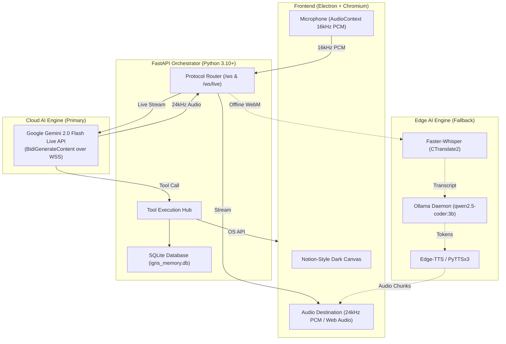
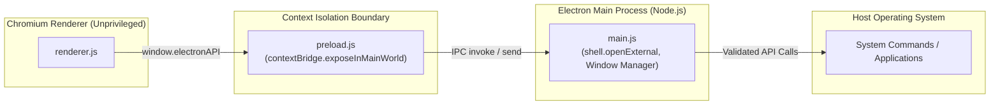

# Architectural Methodology & Engineering Foundations of Igris

This document details the engineering principles, architectural patterns, algorithmic foundations, and system boundaries underlying **Igris** — a sleek, Notion-inspired desktop AI assistant and workspace with real-time Google Voice Assistant capabilities, local-first intelligence, and an integrated IMAP email engine.

---

## 1. System Philosophy & Design Objectives

Igris is engineered to bridge high-parameter Cloud AI, local on-device machine learning, and native operating system control within a single unified workspace. The core design objectives are:

1. **Desktop-First Autonomous Control**: Unlike browser-bound chat interfaces, Igris operates as an unconstrained desktop companion capable of launching applications, querying file systems, reading screens, controlling media, and managing email.
2. **Sub-Second Speech-to-Speech (Google Voice Assistant Parity)**: Emulating Google Assistant requires conversational latency below 800ms. Igris achieves this by streaming raw audio over WebSockets directly to Google's Gemini 2.0 Multimodal Live API, bypassing traditional sequential Speech-to-Text &rarr; Text-to-LLM &rarr; Text-to-Speech serialization bottlenecks.
3. **Graceful Offline Degradation**: An assistant must not become inert without an active internet connection. Igris maintains an edge-compute fallback stack (Faster-Whisper, Ollama running quantized SLMs, and Edge-TTS) that activates automatically when offline or uncredentialed.
4. **Notion Minimalist Information Architecture**: Drawing from Notion's monochromatic, typography-first user interface, Igris rejects hyper-stylized "sci-fi neon" tropes in favor of an ergonomic dark canvas (`#191919`), muted interactive layers (`#202020`, `#252525`), dense relational tables, and slide-out side peeks.
5. **Local Sovereignty & Privacy**: All sensitive user state — conversation memory, long-term facts, IMAP mailbox credentials, and Cloud API keys — resides strictly within a local, unencrypted-at-rest SQLite database (`igris_memory.db`) on the user's host filesystem, with zero third-party telemetry.

---

## 2. Dual-Engine Intelligence Architecture

Igris adopts a **heterogeneous dual-engine design** that decouples conversational voice intelligence from local execution capabilities.

### 2.1 Primary Engine: Google Gemini 2.0 Multimodal Live API
- **Protocol**: Bidirectional asynchronous WebSocket (`wss://generativelanguage.googleapis.com/.../BidiGenerateContent?key=...`).
- **Input Pipeline**: Client-side microphone stream captured via Web Audio API `ScriptProcessorNode`/`AudioWorklet`, converted to mono 16-bit linear PCM at 16,000 Hz, base64 encoded into `realtime_input` messages containing `audio/pcm;rate=16000`.
- **Output Pipeline**: Gemini streams chunks containing 24,000 Hz 16-bit linear PCM (`audio/pcm;rate=24000`), decoded client-side into Web Audio `AudioBuffer` blocks and queued with time-offset scheduling (`audioCtx.currentTime`) for jitter-free acoustic continuity.
- **Function Calling Declarations**: Tool schemas are registered directly into the Gemini session setup handshake (`setup.tools[].functionDeclarations`). Gemini invokes tools in-flight by emitting a `toolCall` frame, pausing speech synthesis while the local Python backend evaluates the tool and submits a `toolResponse` frame, after which Gemini resumes spoken synthesis naturally.
- **Voice Expressivity**: Uses Google's neural audio voices (**Aoede**, **Puck**, **Charon**, **Fenrir**, **Kore**) with expressive intonation and cadence.

### 2.2 Edge Fallback Engine: Whisper + Ollama + Edge-TTS
- **Trigger Condition**: Activated when `aiState.hasKey === false`, `provider === 'local'`, or during network failures.
- **Acoustic Ingestion**: Audio recorded into WebM blobs via MediaRecorder API, sent over standard text/binary WebSocket (`/ws`).
- **Audio Pre-Processing**: Optional spectral gating and denoising via DeepFilterNet (`df_compat.py`).
- **Transcription**: Local inference using `faster-whisper` running a quantized CTranslate2 acoustic model (`base.en` or `small.en`) on CPU/GPU.
- **Inference**: Prompt compiled with rolling conversation memory and submitted to local Ollama instance (`http://127.0.0.1:11434/api/generate`) with `qwen2.5-coder:3b`.
- **Speech Synthesis**: Text output chunked at punctuation boundaries and converted to speech via Microsoft `edge-tts` (or offline fallback `pyttsx3`).

---

## 3. Audio Engineering & Digital Signal Processing (DSP)

A conversational voice assistant requires specialized audio buffering and interruption semantics to prevent latency creep and feedback echo.

### 3.1 Web Audio Ingestion & Resampling
The browser Web Audio API typically operates at the hardware device rate (usually 44,100 Hz or 48,000 Hz). Gemini 2.0 Live strictly expects 16,000 Hz linear PCM.
- **Downsampling Algorithm**: Downsampling is performed on Float32 channel buffers by calculating the sample ratio:
  $$\text{ratio} = \frac{\text{targetSampleRate}}{\text{inputSampleRate}} = \frac{16000}{\text{context.sampleRate}}$$
- **Quantization**: Float32 values $[-1.0, 1.0]$ are clamped and multiplied by $32767$ to produce signed 16-bit Little-Endian integers (`Int16Array`).
- **Packet Cadence**: Audio buffers are dispatched every 100ms–200ms to avoid network buffer bloat while maintaining responsive acoustic streaming.

### 3.2 Dynamic Jitter Buffer & Playback Queue
Audio streamed from Gemini arrives in irregular TCP chunks. Direct playback on arrival causes audio stutter and pop artifacts.
- **Scheduling Model**: A persistent pointer `pcmScheduledTime` tracks the trailing edge of scheduled audio:
  $$t_{\text{next}} = \max(\text{audioCtx.currentTime}, t_{\text{scheduled}})$$
- Each 24kHz PCM chunk is converted to an `AudioBuffer` and enqueued via `AudioBufferSourceNode.start(t_{\text{next}})`.
- $t_{\text{scheduled}}$ advances by $\frac{\text{samples}}{24000}$.
- If network jitter delays arrival, $t_{\text{scheduled}}$ resets to `audioCtx.currentTime` to eliminate cumulative lag.

### 3.3 Native Barge-In (Acoustic Interruption)
A critical flaw of naive voice bots is the inability of the user to interrupt the assistant while it speaks.
- **Detection**: The user's input audio is continuously analyzed via an `AnalyserNode` performing Fast Fourier Transform (FFT) analysis. When root-mean-square (RMS) energy exceeds the speech threshold ($>20$) while the assistant is in state `SPEAKING`, a barge-in event triggers.
- **Client Execution**:
  1. All active `AudioBufferSourceNode` objects in `activePcmSources` are stopped and disconnected immediately.
  2. `pcmAudioQueue` is purged and `pcmScheduledTime = 0`.
  3. Google wave animation is transitioned to `listening`.
- **Protocol Signaling**:
  - In Gemini Live mode, client sends an interruption notification or closes the current generation turn, allowing Gemini's internal server-side acoustic cancellation to drop pending tokens.
  - In Offline mode, a message `{"type": "interrupt"}` is dispatched over `/ws`, terminating the Ollama generation task and Edge-TTS worker.

---

## 4. State Management, Memory & Persistence

Igris employs a multi-tiered memory model to maintain contextual continuity across sessions.

### 4.1 Storage Architecture: SQLite Database
The SQLite file `backend/igris_memory.db` holds persistent application state:
- `conversations`: Primary keys for chat sessions, timestamps, titles.
- `messages`: Chronological turn-by-turn chat history (`role`, `content`, `tokens`, `created_at`).
- `memory_facts`: Extracted user facts (e.g., user name, preferred editor, working directory, frequently asked topics) loaded into the system prompt.
- `settings`: Key-value registry for runtime flags, email credentials, provider configurations, and Gemini API keys.

### 4.2 Concurrency & Thread Safety
Because FastAPI handles concurrent async HTTP requests and WebSocket event loops, access to SQLite connection objects is synchronized using a reentrant mutual exclusion lock (`threading.Lock()` via `with db_lock:`). This prevents database locking errors (`database is locked`) when background IMAP email sync runs concurrently with an active voice session.

### 4.3 Context Window Management & Rolling Summarization
To adhere to LLM context limits and control token consumption:
- The system prompt incorporates the top $N$ memory facts.
- The latest 10–20 conversation messages are injected verbatim into the context payload.
- Earlier messages are summarized into a background context preamble, ensuring the conversation remains coherent without quadratic token growth.

---

## 5. OS Interactivity & Security Isolation Boundaries

Allowing an AI model to interact with the host operating system presents significant safety and stability challenges. Igris isolates execution layers through explicit privilege separation.

### 5.1 Electron Sandboxing & Context Isolation
- `nodeIntegration: false` and `contextIsolation: true` prevent arbitrary script execution in the DOM from accessing Node.js primitives (`child_process`, `fs`).
- Communication flows exclusively through `window.electronAPI` defined in [preload.js](file:///home/voldemort/igris/frontend/preload.js), exposing only vetted methods (`openExternal`, `toggleMiniMode`, `setVoiceModeActive`).

### 5.2 Tool Execution Hub
Host operating system actions are performed through Python backend tools ([main.py](file:///home/voldemort/igris/backend/main.py#L450-L750)) with cross-platform normalization:
- **Application Launcher (`open_app`)**: Resolves app aliases (`vscode` &rarr; `code`, `chrome` &rarr; `google-chrome` on Linux, `start chrome` on Windows, `open -a` on macOS).
- **Terminal Execution (`execute_command`)**: Runs shell commands with a 15-second hard timeout to prevent fork-bombs or hung processes.
- **Media Controller (`media_control`)**: Abstraction layer targeting `playerctl` on Linux, AppleScript on macOS, and Windows virtual key codes.
- **Vision Screen Analysis (`analyze_screen`)**: Uses `mss` for monitor frame grabbing and converts screenshots to compressed JPEG for LLM vision inspection without saving unneeded files to disk.

---

## 6. IMAP Email Protocol & Parsing Methodology

The email integration in Igris ([email_service.py](file:///home/voldemort/igris/backend/email_service.py)) provides direct mailbox interaction without third-party email SaaS APIs.

### 6.1 Direct IMAP4rev1 Implementation
- **Transport**: Secure TLS socket over port 993 (`ssl.create_default_context()`).
- **Provider Profiles**: Built-in host mapping for Gmail (`imap.gmail.com`), Outlook (`outlook.office365.com`), iCloud (`imap.mail.me.com`), and Yahoo (`imap.mail.yahoo.com`), alongside generic custom server support.
- **Credential Model**: Requires dedicated **App Passwords** rather than primary user passwords, protecting the user's primary credentials.

### 6.2 Multipart MIME Decoding & HTML Normalization
Raw email messages contain multipart boundaries, base64/quoted-printable encodings, and complex HTML layouts with tracking pixels.
1. **RFC 2047 Header Decoding**: Subjects and senders containing non-ASCII encoded words (e.g. `=?UTF-8?B?...?=`) are decoded using `email.header.decode_header`.
2. **Body Extraction**:
   - Walks through MIME parts; prefers `text/plain` payloads.
   - If only `text/html` exists, HTML tags, script blocks, inline CSS, and excessive whitespace are stripped using regex sanitization pipelines to yield clean plain text.
3. **Attachment Metadata Extraction**: Identifies filename, content type, and byte size without buffering massive payloads in memory.
4. **Token Budgeting for Summarization**: When feeding emails to Gemini or Ollama for summarization, email bodies are normalized and capped to 3,000 characters per message, preserving header metadata (From, Date, Subject) to maximize LLM comprehension within budget.

---

## 7. Comparative Architectural Trade-Offs

| Decision | Selected Approach | Alternative Considered | Rationale |
| :--- | :--- | :--- | :--- |
| **Voice Streaming Protocol** | Bidirectional WebSockets (Raw PCM) | REST Polling / HTTP Chunked | Sub-second latency requirements require continuous full-duplex audio channels. |
| **Cloud AI Model** | Gemini 2.0 Flash Live | OpenAI Realtime API / Claude 3.5 | Gemini 2.0 Flash offers free tier access via Google AI Studio, native audio-to-audio streaming, and built-in function calling. |
| **Local LLM Runtime** | Ollama (`qwen2.5-coder:3b`) | llama.cpp / vLLM | Ollama provides automated model pulling, simple REST endpoints, and low resource overhead on consumer laptops. |
| **Email Protocol** | Direct IMAP4rev1 (Python stdlib) | OAuth2 + Google/Microsoft Graph REST APIs | Avoids developer console verification barriers, domain hosting requirements, and OAuth redirect server complexity. |
| **UI Paradigm** | Notion Dark Minimalist | Futuristic Cyberpunk HUD / Glowing Orb | Notion's calm slate palette reduces cognitive fatigue, prioritizes text legibility, and integrates structured databases smoothly. |
| **Frontend Framework** | Vanilla JS + Web Audio API | React / Vue / Angular | Eliminates virtual DOM overhead, reduces bundle size, and allows direct low-level control over Web Audio buffers and canvas animation loops. |

