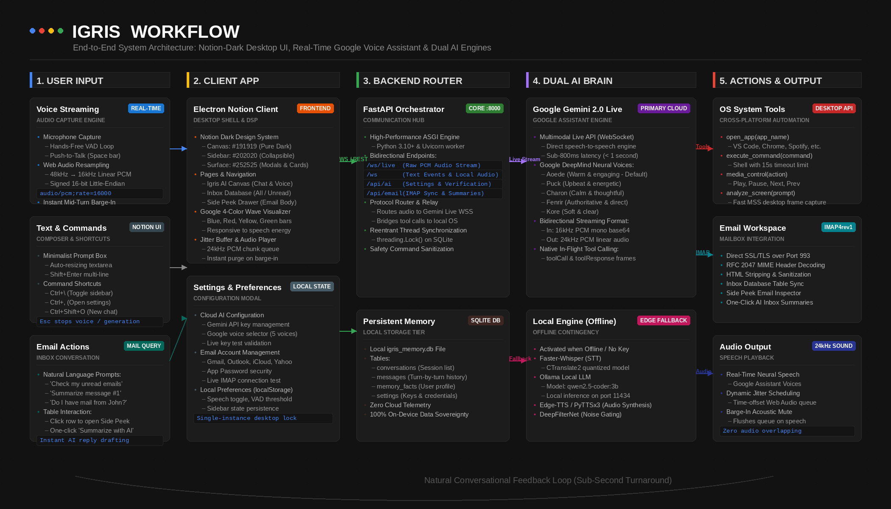
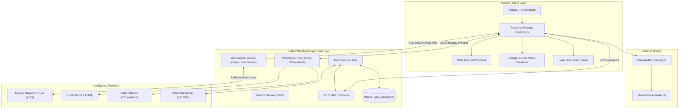
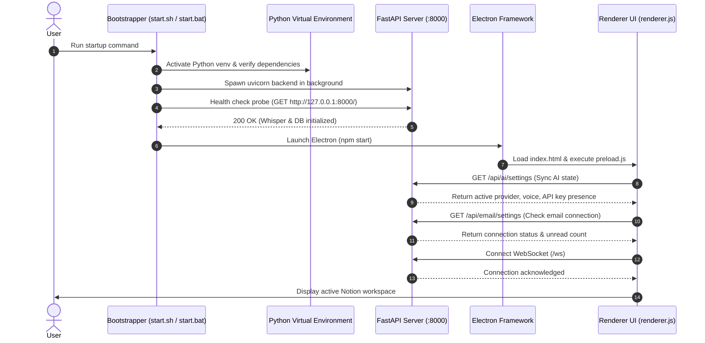
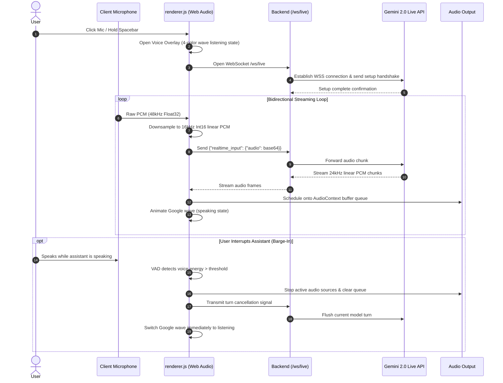
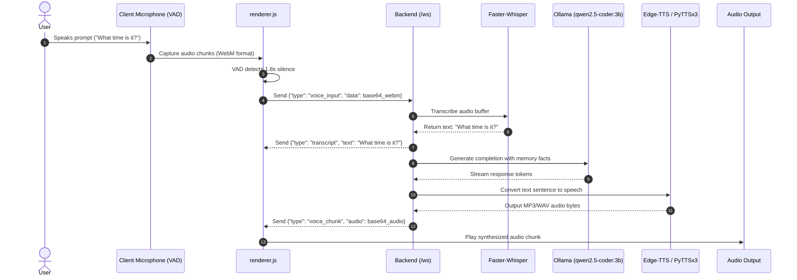
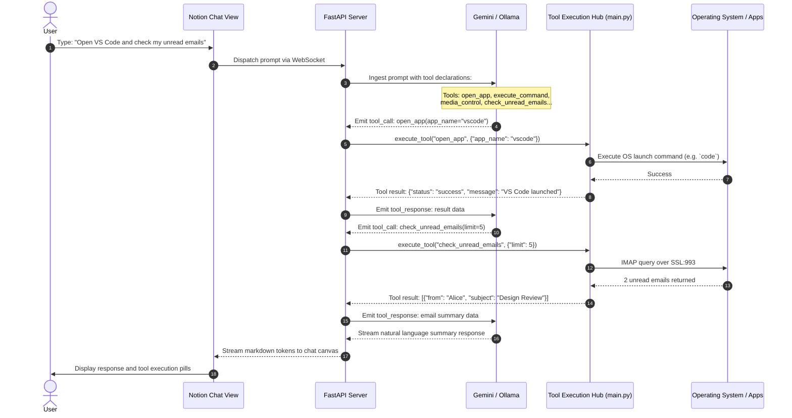
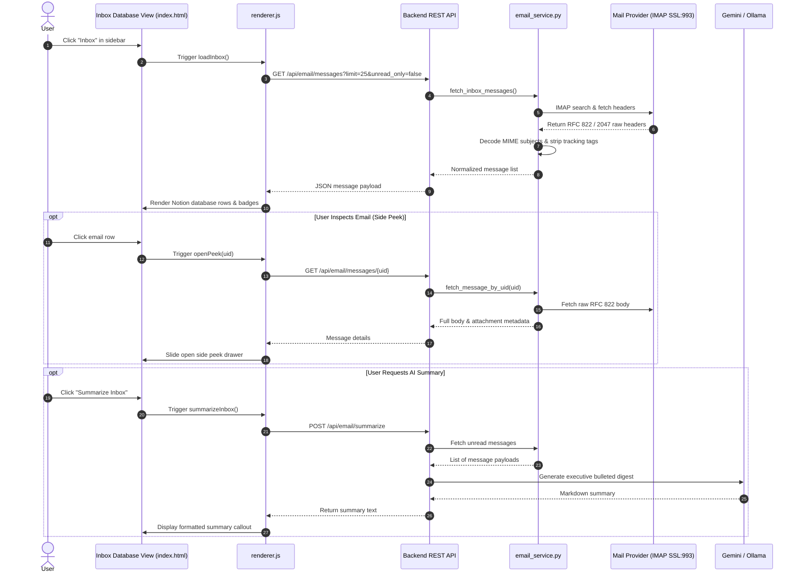
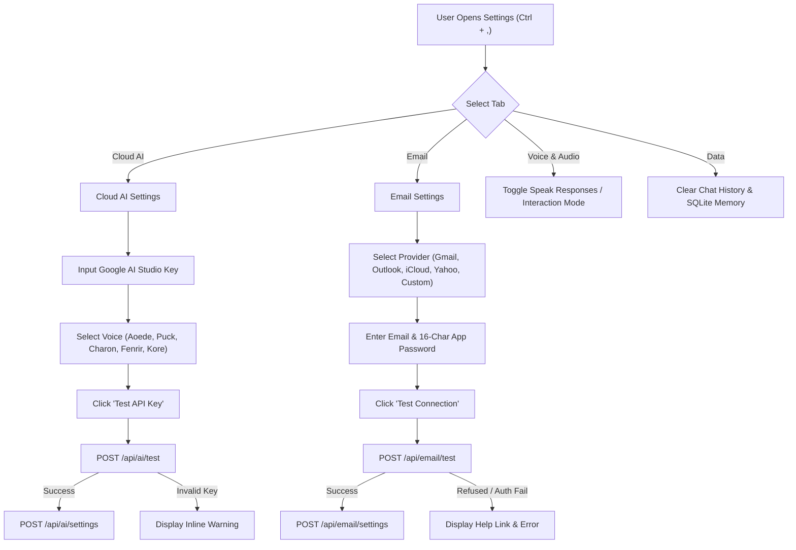

# Operational Workflow & System Execution Guide for Igris

This document details the operational execution flows, component data paths, message protocols, and lifecycle sequences across **Igris**.



---

## 1. End-to-End System Topology



---

## 2. Bootstrapping & Lifecycle Initialization Workflow

The system initializes via platform-specific bootstrap scripts (`start.sh` on Linux/macOS, `start.bat` on Windows).



### Step-by-Step Initialization Trace
1. **Host Environment Check**: Startup script verifies Python $\ge$ 3.10 and Node.js $\ge$ 18.
2. **Backend Instantiation**: Python virtual environment activated; `main.py` starts with SQLite connection initialized and table migrations executed (`conversations`, `messages`, `memory_facts`, `settings`).
3. **Model Warmup**: If local offline mode is active, Faster-Whisper loads acoustic weights into CPU/CUDA memory.
4. **Electron Launch**: Main window opens at $1200\times800$ resolution with a custom dark frame (`#191919`).
5. **State Synchronization**:
   - `loadAiSettings()` queries `/api/ai/settings`. Sets `aiState.hasKey` and configures Gemini voice selection.
   - `loadEmailSettings()` queries `/api/email/settings`. Updates sidebar unread count.
   - `connectWebSocket()` establishes the base `/ws` connection.

---

## 3. Real-Time Google Voice Assistant Workflow (Cloud Live Mode)

When configured with a Google Gemini API key, Igris provides sub-second speech-to-speech with Google DeepMind neural voices and native barge-in.



### Audio Chunk Conversion & Scheduling Detail
1. **Capture**: `navigator.mediaDevices.getUserMedia({ audio: { echoCancellation: true, noiseSuppression: true } })`.
2. **Resampling Node**: `ScriptProcessorNode` (buffer size: 4096) accumulates samples, applies downsampling interpolation to 16,000 Hz, and packs into 16-bit linear PCM format.
3. **Dispatch**: Encoded to base64 and pushed over `/ws/live` every 100ms.
4. **Playback Queue**:
   ```javascript
   function playPcmChunk(int16Data) {
       const float32 = new Float32Array(int16Data.length);
       for (let i = 0; i < int16Data.length; i++) {
           float32[i] = int16Data[i] / 32768.0;
       }
       const audioBuffer = liveAudioCtx.createBuffer(1, float32.length, 24000);
       audioBuffer.getChannelData(0).set(float32);
       const source = liveAudioCtx.createBufferSource();
       source.buffer = audioBuffer;
       source.connect(liveAudioCtx.destination);
       const startTime = Math.max(liveAudioCtx.currentTime, pcmScheduledTime);
       source.start(startTime);
       pcmScheduledTime = startTime + audioBuffer.duration;
   }
   ```

---

## 4. Local Voice Assistant Workflow (Offline Fallback Mode)

When operating offline or without an API key, Igris automatically falls back to the local inference pipeline.



---

## 5. Text Chat & Natural Language Tool Execution Workflow

When the user interacts via text or when an incoming voice prompt requires external system interaction, the tool execution loop runs.



### Available System Tools
- `open_app(app_name)`: Launches applications (`vscode`, `chrome`, `spotify`, `settings`, `terminal`, etc.) using platform-specific commands.
- `execute_command(command)`: Executes shell commands with a 15-second safety timeout.
- `media_control(action)`: Controls system media playback (`play`, `pause`, `next`, `prev`).
- `web_search(query)`: Executes DuckDuckGo searches and returns synthesized snippets.
- `analyze_screen(prompt)`: Captures desktop displays via `mss` and submits screenshots to the vision pipeline.
- `check_unread_emails(limit)`: Retrieves unread emails from the connected IMAP account.
- `read_email_content(uid)`: Fetches and parses full headers and body for a specific email.
- `summarize_inbox()`: Compiles an AI executive summary of recent inbox correspondence.

---

## 6. Integrated Email Workspace Workflow

Igris provides a Notion-style email database table with an interactive side peek drawer and AI-assisted summaries.



---

## 7. Settings, Configuration & Error Recovery Workflows

Igris isolates configuration into a tabbed modal accessible via `Ctrl + ,` or the sidebar button.



### Error Recovery Pathways
1. **Network Disconnection in Live Voice Mode**:
   - If `/ws/live` disconnects, the frontend automatically falls back to local voice processing without crashing the session.
   - An alert toast informs the user: *"Live voice session closed. Switched to offline mode."*
2. **WebSocket Keep-Alive**:
   - Base `/ws` connection runs an automatic exponential backoff reconnection loop ($1\text{s}, 2\text{s}, 4\text{s}, \dots, \max 16\text{s}$) when dropped.
3. **Microphone Permission Denied**:
   - Catches browser `NotAllowedError` or `NotFoundError`. Closes voice overlay gracefully and presents an actionable recovery toast.
4. **IMAP Authentication Timeout**:
   - Network timeouts to IMAP hosts are caught within 10 seconds, preventing blocking of the async FastAPI event loop.

